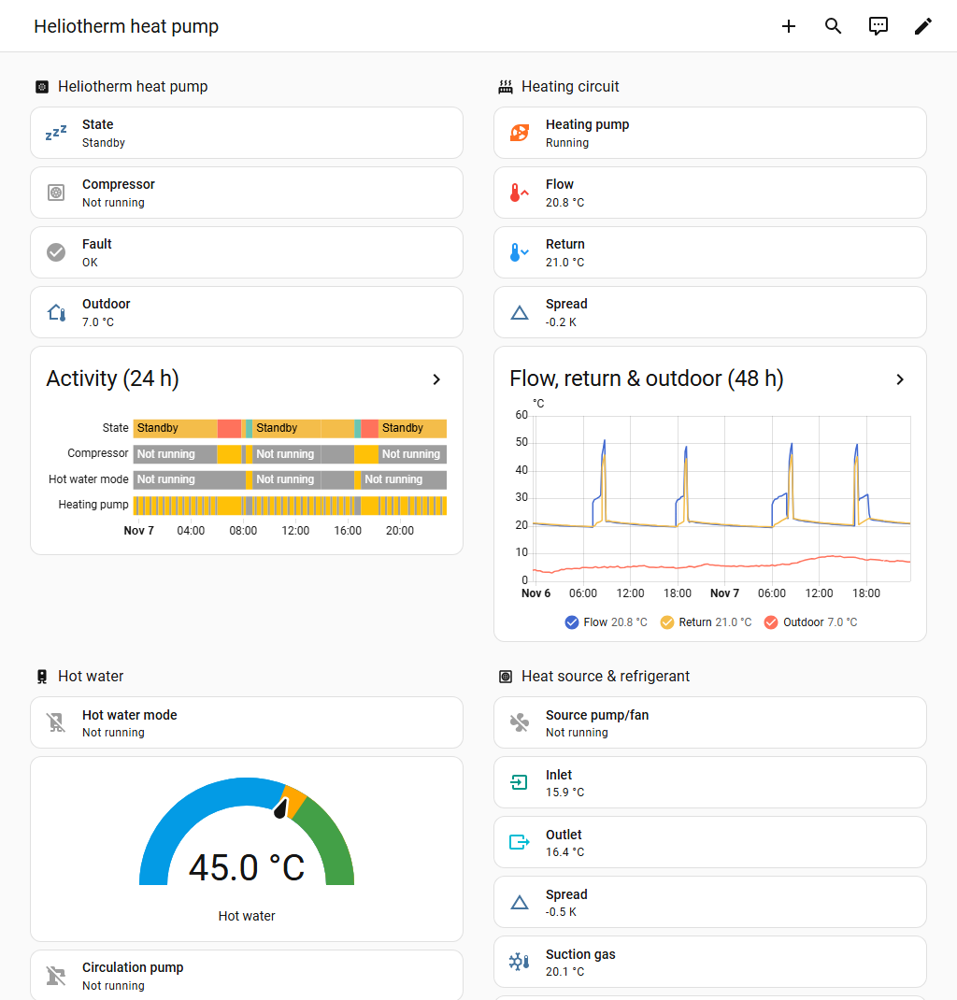
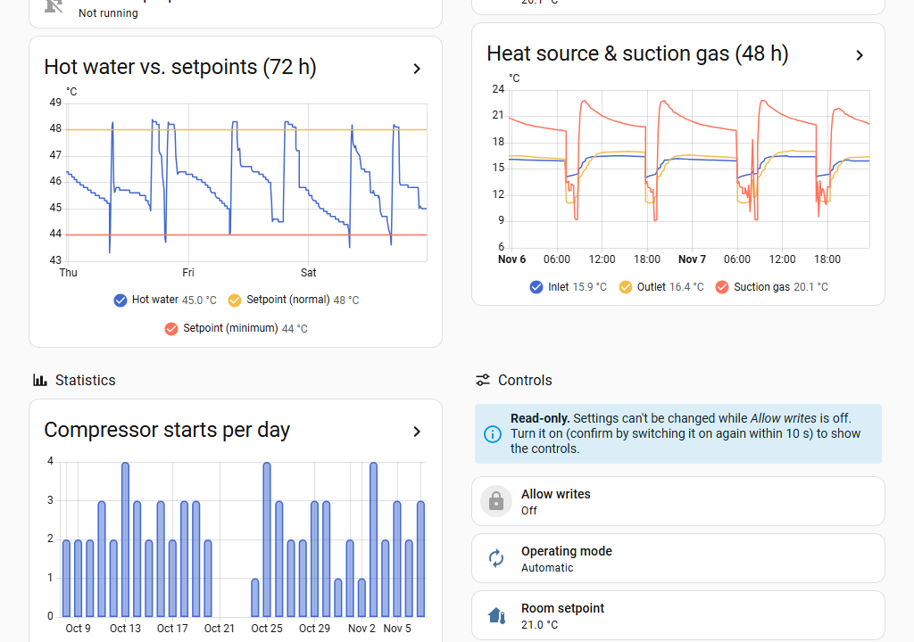
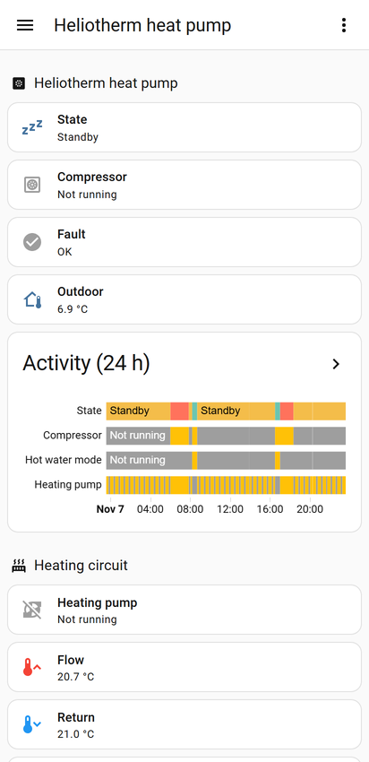
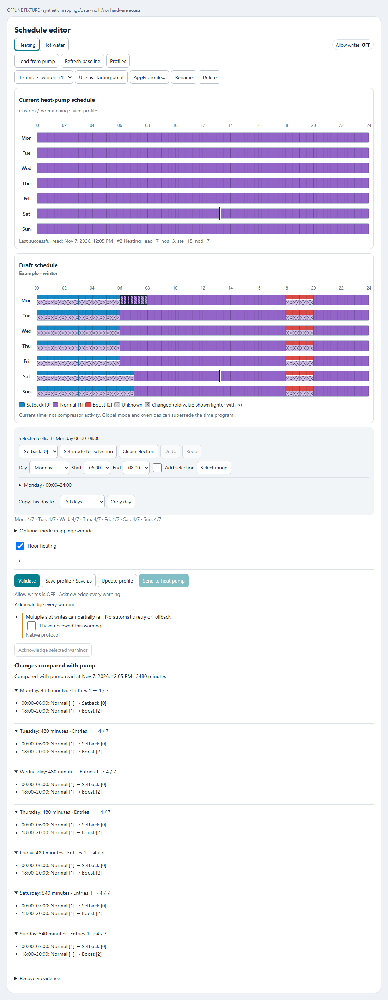

# Ht HA: Heliotherm heat pump for Home Assistant

[](https://github.com/silviuk/htha/releases)
[](https://hacs.xyz/)
[](https://github.com/silviuk/htha/commits/master)
[](LICENSE)

Monitor and control a **Heliotherm** heat pump from Home Assistant over a serial-to-TCP link: live temperatures and states, compressor statistics, setpoints, and weekly heating and hot-water schedules, with a ready-made dashboard included.

[](https://my.home-assistant.io/redirect/hacs_repository/?owner=silviuk&repository=htha&category=integration)
[](https://my.home-assistant.io/redirect/config_flow_start/?domain=htha)



## Highlights

- Live temperatures, operating state, pumps, setpoints, counters and the controller clock.
- Ready-made dashboard that finds your heat pump's entities automatically, on desktop and phone.
- Daily compressor starts and runtimes as long-term statistics.
- Optional weekly schedule editor with validation and a comparison against the pump's current schedule.
- Writes are off by default and need an explicit two-step confirmation.
- English and German labels.

## Screenshots

<table>
  <tr>
    <td width="68%"></td>
    <td width="32%"></td>
  </tr>
  <tr>
    <td>History charts, daily statistics and controls (read-only until writes are allowed)</td>
    <td>The same dashboard on a phone</td>
  </tr>
</table>

Screenshots are from a live HP07S08W-S-WEB. The schedule editor is shown further down under [Schedule editor](#schedule-editor).

## Supported hardware and connection

Tested with **Heliotherm HP07S08W-S-WEB**. Other Heliotherm and Brotje models with a compatible serial/TCP interface may work; compatibility depends on the controller.

Connect the serial port through a serial-to-TCP adapter or [ser2net](https://github.com/cminyard/ser2net). Example:

```yaml
connection: &htheatpump
  accepter: tcp,9999
  connector: serialdev,/dev/ttyUSB0,9600n81,local
  options:
    max-connections: 2
```

Use the serial settings required by your controller (typically 9600 baud, 8N1). The integration installs its pinned [htheatpump](https://github.com/silviuk/htheatpump) dependency automatically.

## Installation

### HACS (recommended)

[](https://my.home-assistant.io/redirect/hacs_repository/?owner=silviuk&repository=htha&category=integration)

Or add it by hand: in HACS open the menu, choose **Custom repositories**, add `https://github.com/silviuk/htha` with type **Integration**, then download **Ht HA**. Restart Home Assistant afterwards.

### Manual

 Copy [`custom_components/htha`](custom_components/htha) into your Home Assistant `custom_components` directory, then restart.

## Setup

[](https://my.home-assistant.io/redirect/config_flow_start/?domain=htha)

Or go to **Settings > Devices & services > Add integration** and search for **Ht HA**. Enter:

| Field | Value |
| --- | --- |
| Host | Serial/TCP server hostname or IP address |
| Port | Default `9999` |
| Timeout | Default `10` seconds |
| Scan interval | Default `30` seconds |
| Enable writes | Optional second step; disabled by default |

Under the integration's **Configure** options, choose exposed parameters, adjust the scan interval and optionally enter the model from the nameplate. Model is display-only. Serial number and firmware are read once per load and cached; unsupported identity reads do not stop polling. Saving options reloads the integration.

## Dashboard

**Do I get the dashboard when I install htha? Yes:** the dashboard strategy and schedule editor card are bundled and loaded automatically. **Home Assistant does not create a dashboard by itself.** Add one using the configuration below.

For a whole dashboard, go to **Settings > Dashboards > Add dashboard**, create a dashboard from scratch, then open **Edit > Raw configuration editor** and paste:

```yaml
strategy:
  type: custom:htha-heatpump
```

For a single view, add this view configuration under an existing dashboard's `views:` list:

```yaml
- strategy:
    type: custom:htha-heatpump
```

For a single section, add this under `sections:` in a `type: sections` view:

```yaml
- strategy:
    type: custom:htha-heatpump
    section: schedule
```

The strategy discovers entities by integration and translation key, so renamed entity IDs work. A whole dashboard creates one view per heat pump. Sections are `overview`, `heating`, `hot_water`, `source`, `statistics`, `controls`, `schedule` and `diagnostics`. Use `device_id` to select a pump, or `sections: [overview, heating, hot_water, controls, schedule]` to choose sections on a dashboard/view strategy.

The **schedule** section shows the editor automatically when it can discover the schedule validation sensor and its config entry ID. Set `schedule_editor: false` in the strategy configuration to use the read-only time-program view. That view also serves as a fallback when editor discovery is incomplete. Its `time_programs` option accepts `full`, `summary` or `collapsible`; the last uses `input_boolean.htha_show_time_programs` by default when that helper exists, or a helper named by `time_programs_toggle`.

Prefer explicit cards? Copy [`dashboards/heliotherm_heatpump.yaml`](dashboards/heliotherm_heatpump.yaml) into the raw editor and adjust entity IDs. This static dashboard uses built-in cards. You can also use **Take control** on a strategy dashboard to customize its generated cards.

To add the editor independently, use [`dashboards/schedule-editor-v2.yaml`](dashboards/schedule-editor-v2.yaml), replacing the validation sensor and config entry ID:

```yaml
type: custom:htha-schedule-scratchpad-card
entity: sensor.heliotherm_schedule_validation
config_entry_id: YOUR_HTHA_CONFIG_ENTRY_ID
```

No manual resource is normally needed. Both scripts are served under `/htha_frontend/`, loaded through the frontend and registered as versioned JavaScript modules in storage-mode resources. Existing matching resources are updated; only resources created by htha are removed when its last entry is deleted. YAML resource lists are not edited; if explicit resources are needed, add these with `type: module`:

```yaml
- url: /htha_frontend/htha-heatpump-strategy.js?v=1.3.2
  type: module
- url: /htha_frontend/htha-schedule-scratchpad-card.js?v=1.3.2
  type: module
```

## Schedule editor



Edit recurring quarter-hour cells in a weekly grid, select multiple cells, assign modes and copy days. Validate to see findings and a diff before sending. Save personal profiles or start from the read-only **Factory default (Heliotherm)** profiles for heating and hot water.

Changed draft slots keep the new mode color in the top 40%; the lower part shows the replaced pump mode tinted against the card background with an ×. Both the week overview and expanded day update as you edit, using the current pump schedule already available in the card. Unknown baseline slots have no replacement mark.

Verified mapping for **firmware 2.03N**: heating **0 Setback / 1 Normal / 2 Boost**; hot water **0 Off / 1 On**. Other firmware or incompatible metadata requires a verified mapping override. Hot water Off retains the controller's minimum-temperature maintenance; Normal does not mean continuous compressor operation.

Sending requires Allow writes, fresh validation, verified modes, acknowledgement of warnings and explicit confirmation. Writes are read back for verification and can fail partially; there is no automatic retry or rollback. Firmware 2.03N schedule writes remain unverified on hardware. See [schedule editor details and recovery](docs/schedule-scratchpad.md).

## Entities

Names follow the device name and are translated into English and German.

| Type | Examples |
| --- | --- |
| Sensors | Outdoor, hot water, flow/return, heat source and refrigerant temperatures; pressures |
| Derived sensors | Operating state, heating spread, heat source spread |
| Statistics | Compressor starts and runtimes for compressor, heating/source pumps and hot water |
| Binary sensors | Fault, compressor, heating/source/circulation pumps, hot water mode |
| Numbers | Room and hot water setpoints, heating curve and other selected settings |
| Select | Operating mode |
| Configuration | Allow writes switch, heat pump clock, Sync clock button |
| Schedules | Time programs and schedule validation |

Read-only sensor twins of number/select parameters are diagnostic and disabled by default on new installs. Enable them if you need long-term setpoint statistics. Existing entity IDs and custom names are retained across display-name updates.

## Write protection

Writes are disabled by default. Turn on **Allow writes to heat pump**, then turn it on again within 10 seconds to confirm. With writes off, settings remain visible but input controls are hidden and changes are rejected. Turn writes off when finished. The schedule editor displays this permission but cannot enable it; its separate validation and confirmation gates still apply.

## Troubleshooting

- **Cannot connect / unavailable entities:** Check the configured host/port, serial server, cable and serial settings, then inspect Home Assistant logs. Reload the integration after correcting the connection.
- **Cannot change a setting:** Confirm Allow writes is on and the parameter is writable. For schedules, review every missing gate shown by the editor.
- **Strategy registration timeout** (`ll-strategy-section-htha-heatpump`): Restart Home Assistant and reload the page. In the Companion app, refresh or clear the frontend cache under its troubleshooting settings. Check that the current versioned modules load; the static YAML dashboard is an alternative.
- **Daily runtime bars:** Controller hour counters generally update shortly after midnight, so the current day can stay at zero. Reusing old entity IDs can resume an old statistics series and book a gap in one hour, producing a bar above 24 h. Correct that hour using **Developer tools > Statistics > Adjust sum** rather than deleting statistics.

For debug logs:

```yaml
logger:
  logs:
    custom_components.htha: debug
    htheatpump: debug
```

## Development and tests

Use a Python environment compatible with Home Assistant, the pinned integration dependency, `pytest`, `pytest-asyncio` and `pytest-homeassistant-custom-component`. Run from the repository root:

```bash
pytest
node --test tests/
```

The Node suite uses built-in test tools and offline fixtures; Python integration tests use mocked transport. See [schedule verification details](docs/schedule-scratchpad.md#offline-verification) for optional local visual checks.

## Credits

Based on [htheatpump](https://github.com/silviuk/htheatpump) by Daniel Strigl and inspired by the [original Home Assistant integration](https://github.com/dstrigl/htheatpump).

## License

[MIT](LICENSE), copyright 2026 Silviu Vlasceanu.

## Disclaimer

Incorrect settings can damage equipment or reduce efficiency. Use at your own risk; the software is provided without warranty. Review changes against your controller's documentation before sending them.
